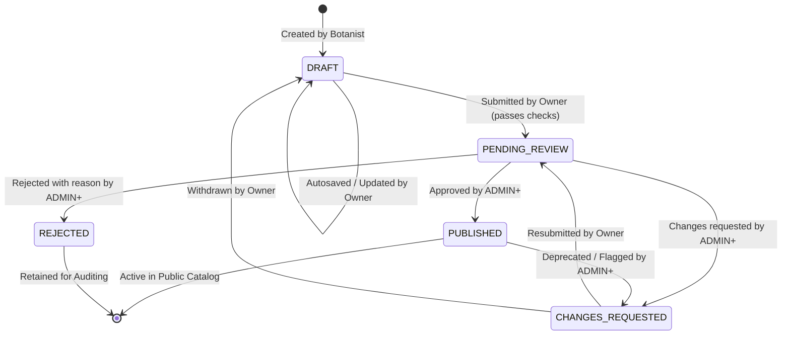

# Botanist Contributions & Content Lifecycle Architecture — Virtual Herbal Garden

## Overview

The Virtual Herbal Garden botanical contribution pipeline allows verified Botanists (`BOTANIST`, role tier 2) to draft, iterate, and submit medicinal plant profiles and herbal remedies. All submissions undergo structured editorial review by Administrators (`ADMIN`, role tier 3) or Super Administrators (`SUPER_ADMIN`, role tier 4) before being published to the public library.

This document details the content lifecycle state machine, role permission matrix, medicinal safety compliance rules, submission completeness criteria, and API reference.

---

## 1. Content Status Lifecycle

Every contributed entity (`Plant` and `Remedy`) possesses a `status` field governing its visibility and mutability:



### State Definitions

| Status | Meaning | Public Visibility | Who Can Edit | Actions Available |
| :--- | :--- | :--- | :--- | :--- |
| `DRAFT` | Work-in-progress authored by Botanist. | Hidden | Owner only | Autosave, Delete, Submit for Review |
| `PENDING_REVIEW` | Locked and queued in Admin review queue. | Hidden | ADMIN+ only | Approve, Request Changes, Reject |
| `CHANGES_REQUESTED` | Returned to Botanist with feedback notes. | Hidden | Owner & ADMIN+ | Revise, View Feedback, Resubmit |
| `PUBLISHED` | Formally approved and live in the garden. | Visible | ADMIN+ | View live, View history |
| `REJECTED` | Ineligible for publication with recorded reason. | Hidden | ADMIN+ | Audit review |

### Database Integrity & `isPublished` Synchronization
To preserve zero regression with legacy queries expecting `isPublished: boolean`, Mongoose pre-save middleware automatically synchronizes:
```typescript
this.isPublished = this.status === ContentStatus.PUBLISHED;
```
All public queries (`/plants`, `/remedies`, `/home`, search) strictly enforce `{ status: 'PUBLISHED' }` (or `{ isPublished: true }`). Drafts and unapproved submissions are strictly invisible to anonymous users and regular authenticated users (`USER`).

---

## 2. Role & Permission Matrix

| Operation | GUEST (0) | USER (1) | BOTANIST (2) | ADMIN (3) | SUPER_ADMIN (4) |
| :--- | :---: | :---: | :---: | :---: | :---: |
| View Public Library & Remedies | Yes | Yes | Yes | Yes | Yes |
| View Own Contributions (`/dashboard/contributions`) | No | No | Yes (Own) | Yes (All) | Yes (All) |
| Create Plant / Remedy Draft | No | No | Yes | Yes | Yes |
| Edit Draft / Changes Requested | No | No | Yes (Owner) | Yes | Yes |
| Delete Own Draft | No | No | Yes (Owner) | Yes | Yes |
| Submit Draft for Review | No | No | Yes (Owner) | Yes | Yes |
| Approve Submission (`PUBLISHED`) | No | No | No | Yes | Yes |
| Request Changes (`CHANGES_REQUESTED`) | No | No | No | Yes | Yes |
| Reject Submission (`REJECTED`) | No | No | No | Yes | Yes |
| AI Feedback Verification Queue | No | No | Yes | Yes | Yes |

---

## 3. Medicinal Content Safety Guidelines

To prevent harmful health misinformation and comply with international medical advertising and botanical research standards, automated content safety scanning (`contentSafety.ts`) is enforced at the backend service layer on every plant and remedy draft save and submission.

### Disallowed Safety Phrases

The following words or phrase patterns trigger a `400 Bad Request` safety error:
1. `"cures"` / `"cure"` / `"curative"`
2. `"guaranteed"`
3. `"100% effective"` / `"100% cure"`
4. `"miracle"` / `"miracle cure"`
5. `"no side effects"` / `"zero side effects"`

### Mandatory Traditional Disclaimer

Any submitted remedy or plant must treat health benefits in the context of traditional, educational knowledge:
- Use phrases such as *"traditionally used for"*, *"may support"*, or *"studied in herbal medicine for"*.
- Never guarantee therapeutic outcomes or claim to replace conventional clinical treatments.
- A standardized medical disclaimer is attached on all public pages.

### Citations & Academic References
Every published plant profile and remedy must provide at least one valid academic citation or reference (e.g., Ayurvedic Pharmacopoeia of India, WHO Monographs on Selected Medicinal Plants, PubMed DOI, or botanical textbooks).

---

## 4. Completeness Checklist Criteria

Submissions cannot transition to `PENDING_REVIEW` unless all required fields are validated. The frontend editors provide a live "Ready for review: X/Y" counter.

### Plant Profile Checklist (8 Criteria)
1. **Common Name**: Valid string ($\ge 2$ characters).
2. **Scientific / Botanical Name**: Binomial nomenclature (e.g., *Ocimum sanctum*).
3. **Botanical Family**: Recognized plant family (e.g., *Lamiaceae*).
4. **Description**: Informative overview ($\ge 30$ characters).
5. **Medicinal Uses / Health Benefits**: At least one health category tag.
6. **Parts Used**: At least one recognized plant part (`leaves`, `roots`, `bark`, etc.).
7. **Precautions & Warnings**: Clear contraindications or safety precautions.
8. **Academic References**: At least one documented source or literature citation.

### Herbal Remedy Checklist (7 Criteria)
1. **Remedy Title**: Descriptive name.
2. **Target Ailments**: At least one indicated condition.
3. **Preparation Time**: Valid time in minutes.
4. **Step-by-Step Instructions**: Minimum 2 detailed preparation steps.
5. **Ingredients**: Minimum 1 ingredient with quantity and optional plant reference.
6. **Precautions & Dosage**: Clear traditional dosage guidance and warnings.
7. **Academic References**: At least one documented literature citation.

---

## 5. API Reference

### Botanist Contributions Endpoints (`/api/v1/contributions`)

All endpoints require authentication with role `BOTANIST` (2) or higher:

| Method | Path | Description |
| :--- | :--- | :--- |
| `GET` | `/contributions/metrics` | Retrieves aggregate metrics (total, pending, published, drafts, changes requested). |
| `GET` | `/contributions/mine` | Retrieves paginated submissions authored by the current user with status and type filters. |
| `GET` | `/contributions/plants/:id` | Retrieves a single plant contribution (owner or ADMIN+). |
| `POST` | `/contributions/plants` | Creates a new plant draft. |
| `PUT` | `/contributions/plants/:id` | Updates an existing plant draft. |
| `DELETE` | `/contributions/plants/:id` | Deletes a plant draft (allowed only when `DRAFT` or `CHANGES_REQUESTED`). |
| `POST` | `/contributions/plants/:id/submit` | Validates completeness and transitions plant from `DRAFT` to `PENDING_REVIEW`. |
| `GET` | `/contributions/remedies/:id` | Retrieves a single remedy contribution. |
| `POST` | `/contributions/remedies` | Creates a new remedy draft. |
| `PUT` | `/contributions/remedies/:id` | Updates an existing remedy draft. |
| `DELETE` | `/contributions/remedies/:id` | Deletes a remedy draft. |
| `POST` | `/contributions/remedies/:id/submit` | Validates completeness and transitions remedy from `DRAFT` to `PENDING_REVIEW`. |
| `GET` | `/contributions/search?q={query}` | Authenticated grouped search across plant and remedy contributions. |

### Admin Review Endpoints (`/api/v1/admin`)

Requires authentication with role `ADMIN` (3) or higher:

| Method | Path | Description |
| :--- | :--- | :--- |
| `POST` | `/admin/plants/:id/approve` | Approves plant and sets status to `PUBLISHED`. |
| `POST` | `/admin/plants/:id/reject` | Rejects plant with a required rejection reason. |
| `POST` | `/admin/plants/:id/request-changes` | Sets status to `CHANGES_REQUESTED` with feedback notes. |
| `POST` | `/admin/remedies/:id/approve` | Approves remedy and sets status to `PUBLISHED`. |
| `POST` | `/admin/remedies/:id/reject` | Rejects remedy with a required rejection reason. |
| `POST` | `/admin/remedies/:id/request-changes` | Sets status to `CHANGES_REQUESTED` with feedback notes. |

---

## 6. AI Detection Verification Queue

The AI verification system allows Botanists to validate scanned detections generated by users while maintaining user anonymity:

1. **Anonymized Queue**: `GET /api/v1/ai/feedback-queue` strips all user identifiers (`userId`, IP addresses) from scan records.
2. **Review Verdicts**: Botanists record an authoritative verdict:
   - `CORRECT`: AI identified the plant correctly.
   - `INCORRECT`: AI misidentified the plant; Botanist selects the true plant from the verified catalog.
   - `NOT_A_PLANT`: Scanned image was non-botanical (inanimate object, animal, etc.).
   - `UNSURE`: Image is blurry, degraded, or insufficient for conclusive identification.
3. **Feedback Tracking**: `POST /api/v1/ai/detect/:id/feedback` records or updates the Botanist's evaluation.
4. **Accuracy Stats**: `GET /api/v1/ai/feedback-stats` computes aggregate model precision and community review metrics.
